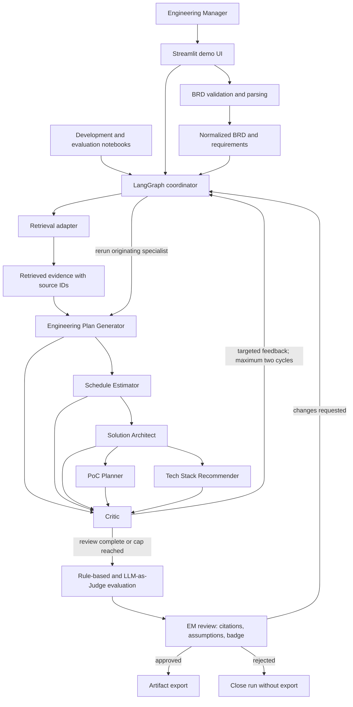
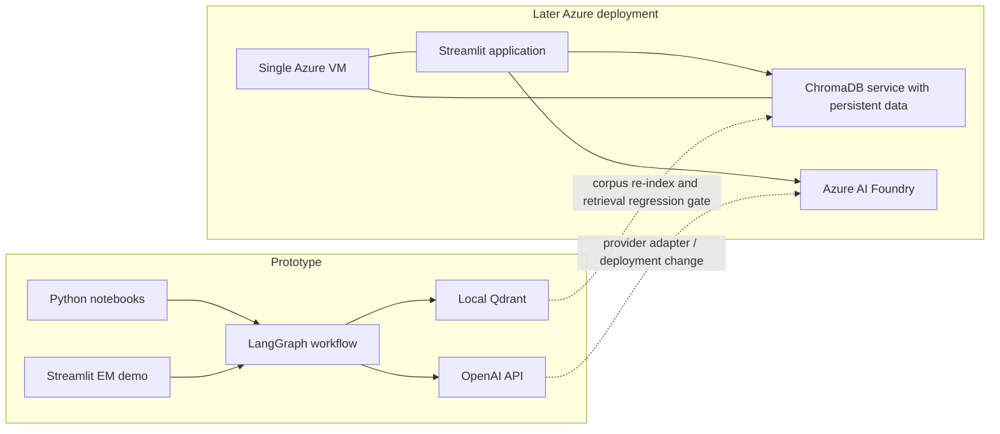

# Architecture Spine — Engineering Manager BRD-to-Engineering System

## Design Paradigm

**Hub-and-spoke workflow orchestration:** LangGraph coordinator owns each run's state and routes validated, versioned contracts between specialist agents. The coordinator establishes a dependency-ordered workflow; specialists do not invoke one another or mutate shared run state directly.

## Invariants & Rules

### AD-1 — [ADOPTED] Coordinator-owned hub-and-spoke workflow

- **Binds:** All seven agents and every end-to-end BRD run.
- **Prevents:** Agents choosing incompatible routing, retry, or state-mutation paths.
- **Rule:** Implement one LangGraph coordinator as the sole owner of run state and transitions. Agent nodes receive typed inputs and return typed results; they must not mutate shared state or call other agents directly.



### AD-2 — [ADOPTED] Dependency-ordered specialist handoffs

- **Binds:** Planning and design artifact generation.
- **Prevents:** Schedules detached from plan phases and design outputs based on contradictory upstream assumptions.
- **Rule:** The coordinator runs Engineering Plan Generator first; Schedule Estimator consumes the validated plan; Solution Architect consumes the normalized BRD, retrieved evidence, and plan; PoC Planner and Tech Stack Recommender consume the normalized BRD and validated upstream plan/design context. The Critic reviews all five specialist outputs together for cross-artifact consistency. Only independent work may be parallelized without changing these input dependencies.

### AD-3 — [ADOPTED] Seven agents with validated, versioned contracts

- **Binds:** Coordinator, Planning, Design, and Critic agent boundaries.
- **Prevents:** Independently implemented agents from disagreeing about ownership, fields, or downstream handoffs.
- **Rule:** Keep exactly these seven roles and define and test one versioned Pydantic contract per role before implementing its handoffs: (1) Orchestrator — run state and routing result; (2) Engineering Plan Generator — phases, milestones, risks, and team composition, with a required reflection/self-review before submission; (3) Schedule Estimator — estimates, dependencies, timeline, and resource allocation; (4) Solution Architect — components, data flows, and NFR mapping; (5) PoC Planner — scope, modular boundaries, and measurable success criteria; (6) Tech Stack Recommender — two or three options compared on scalability, team familiarity, integration risk, and cost; (7) Critic — rubric scores, cross-artifact issues, specific revision feedback, and badge. Validate each contract at every handoff; incompatible contract changes require a version change.

### AD-4 — [ADOPTED] Shared evidence and uncertainty envelope

- **Binds:** All generated artifact contracts and exports.
- **Prevents:** Claims, assumptions, or unresolved requirements becoming detached from their source or silently changing meaning across agents.
- **Rule:** Each artifact carries its run/artifact identity, contract version, source requirement references, citations, assumptions, unresolved uncertainty items, and revision number. Use one shared citation object with `source_id`, `chunk_id`, and `source_locator`; IDs must resolve to the run's retrieved source set. Use one shared uncertainty object with an ID, type (ambiguity, contradiction, assumption, or question), source requirement references, owner, and status; every downstream artifact must propagate unresolved items or record their reviewed disposition. Validate BRD file type and structure before processing. Every generated requirement links to a source requirement; anything not source-backed is explicitly an assumption and cannot become an approved requirement without EM disposition. Every non-trivial claim cites at least one retrieved chunk.

### AD-5 — [ADOPTED] Bounded Critic loop and common quality outcomes

- **Binds:** Critic, all Planning and Design artifacts, and EM quality badges.
- **Prevents:** Unbounded revision cycles and inconsistent quality interpretation between artifacts.
- **Rule:** The Critic evaluates completeness, groundedness, actionability, and cross-artifact consistency using one versioned rubric and shared scoring rules; groundedness evaluation flags unsupported claims against BRD requirements and retrieved evidence. Feedback identifies the originating artifact and a specific correction. Permit at most two revision cycles per artifact. After the cap, retain unresolved findings and deliver the artifact with the appropriate Amber or Red badge for EM disposition. Apply the common thresholds: at least 75% of non-trivial claims cited; 100% of BRD sections covered; zero cross-artifact contradictions; actionability at least 4/5. Compute each artifact badge and an aggregate run badge deterministically from the same rubric. If retrieval returns no usable evidence, show a disclaimer and cap the artifact at Amber; it cannot be Green. Green requires all thresholds met and overall score at least 4.0; Amber means one threshold missed or overall 3.0–3.9; Red means two or more thresholds missed or overall below 3.0.

### AD-6 — [ADOPTED] Provider-neutral model access and evaluated model catalog

- **Binds:** All agent and embedding calls, the EM model selector, and evaluation runs.
- **Prevents:** Provider-specific SDK logic leaking into contracts and untested model changes silently reducing artifact quality.
- **Rule:** Route model calls through provider adapters. Use OpenAI API initially and keep Azure AI Foundry as the planned provider. The EM selects generation models per run and embedding models when creating/rebuilding an index, only from an evaluation-passed catalog with plain-language quality/cost labels. Record provider, exact model IDs/snapshots, and evaluation/catalog version per run and index. Initial candidates are `gpt-4.1-mini` for generation and `text-embedding-3-small` for embeddings; verify lifecycle, account/region availability, structured-output support, and evaluation results before admitting either to the catalog. Pin the generation model for a run and embedding model for an index; queries must use the model recorded by that index, and a mismatch fails explicitly rather than triggering an implicit rebuild.

### AD-7 — [ADOPTED] Explicit vector-store migration boundary

- **Binds:** Knowledge ingestion, retrieval, and local-to-Azure transition.
- **Prevents:** Silent retrieval changes or invalid vector queries when moving between Qdrant and ChromaDB or changing embedding models.
- **Rule:** Access vector storage through one retrieval/index adapter. Use local Qdrant for the prototype and keep ChromaDB as the conditional Azure target selected by the user. Do not deploy the currently checked ChromaDB release: a public advisory reports a critical server-side issue affecting releases through 1.5.9, and a fixed release was not verified at authoring. Azure cutover is blocked until a patched, security-cleared ChromaDB release is confirmed; otherwise keep Qdrant as the Azure store or revisit the target. Persist index metadata including store, collection, embedding provider/model/snapshot, dimensions, and corpus version. Migration or embedding-model change requires rebuilding from source documents and passing a versioned retrieval regression suite (fixed queries, expected relevant chunk IDs, metric, and threshold) before cutover; define the threshold before the migration run. The prototype corpus contains at least five varied sources spanning BRDs, plan templates, architecture patterns, timelines, engineering standards, and decision records; retrieval evaluation includes both relevant and deliberately poor matches. Never treat vector stores or embedding spaces as interchangeable.

### AD-8 — [ADOPTED] Confidential input and secret handling

- **Binds:** BRD uploads, prompts, model calls, traces, and operational logs.
- **Prevents:** Proprietary BRD content or credentials leaking through logs, notebooks, or unapproved model endpoints.
- **Rule:** Use synthetic or anonymized BRDs for the prototype. Do not write raw BRD text to application logs, evaluation traces, or telemetry; log input hashes, artifact/output hashes or IDs, retrieved chunk IDs, Critic/evaluation scores, execution time, guardrail triggers, revision counts, and non-content metadata as structured JSON. Keep API credentials outside source code and notebooks in runtime secrets. Production use of real BRDs requires an approved provider/data boundary; only send content to the configured, approved endpoint.

### AD-9 — [ADOPTED] Human approval gates externalization

- **Binds:** EM review, quality badges, and artifact export.
- **Prevents:** Unreviewed, low-confidence, or unsupported outputs being treated as approved engineering commitments.
- **Rule:** The Streamlit EM experience presents artifacts with citations, assumptions, unresolved questions, revision history, and per-artifact/aggregate badges. Approval binds to the exact run and artifact revisions being exported; any revision invalidates approval for the changed artifact. Export only after explicit EM approval; rejection closes the run without export, and requested changes route through the coordinator and bounded review loop.

### AD-10 — [ADOPTED] Evaluation methods are explicit and comparable

- **Binds:** Model catalog admission, revision tracking, and release readiness.
- **Prevents:** Model selection and quality claims based solely on subjective inspection or non-comparable runs.
- **Rule:** Run both deterministic rule-based checks and LLM-as-Judge evaluation for groundedness, completeness, actionability, and consistency. The versioned evaluation dataset covers simple, medium, and complex BRDs plus missing NFRs, contradictions, and ambiguity. Use the same dataset, rubric, and scoring implementation when comparing models or revisions; retain score-per-revision and before/after artifacts, and demonstrate improvement on at least two metrics in a comparison report. Only expose a model as EM-selectable after it passes the configured quality gates. Keep evaluator output distinct from the Critic's revision feedback.

### AD-11 — [ADOPTED] Prototype and initial Azure deployment topology

- **Binds:** User-facing demo, vector database deployment, and operating boundary.
- **Prevents:** The prototype and first deployment assigning ownership of the app or vector index to competing services.
- **Rule:** Develop and evaluate in Python notebooks; provide the EM demo through Streamlit. For the initial Azure deployment, host Streamlit and the security-cleared target vector service on one Azure VM, with vector data on persistent storage and access restricted to the application. ChromaDB may occupy that role only after AD-7's security and migration gates pass. Treat this as a low-concurrency starting topology, not a high-availability design; define backup, recovery, network isolation, and scale requirements before production use.

### AD-12 — [ADOPTED] Explicit tool contracts and external integration

- **Binds:** BRD parsing, knowledge retrieval, artifact export, and EM workflow integrations.
- **Prevents:** Tool calls being hidden inside prompts or independently implemented with incompatible input, output, and error behavior.
- **Rule:** Expose parser, retrieval, and export operations as typed tool interfaces with validated inputs, outputs, and explicit errors. The prototype demonstrates at least one external integration using mock data; optional destinations such as Jira, PDF, and Markdown remain selectable implementation targets.

### AD-13 — [ADOPTED] Operational readiness and prototype acceptance

- **Binds:** Pre-release gates, monitoring, and the mandatory prototype demonstration.
- **Prevents:** A technically functioning graph being treated as a safe, measurable, or complete deliverable without operational evidence.
- **Rule:** Before release, define at least three measurable success criteria and three failure modes with mitigations; include schema-invalid output, no usable RAG evidence, and Critic revision-cap handling. Gate release on input/contract/guardrail tests, evaluation thresholds, one end-to-end synthetic BRD, and structured per-agent operational records. The prototype evidence includes the required documentation package and reproducible setup; the demo shows citations, badges, Critic before/after scores, guardrails, evaluation results, and operational behavior.

## Consistency Conventions

| Concern | Convention |
| --- | --- |
| Agent and artifact identity | Stable `run_id`, `artifact_id`, and versioned Pydantic contract; each agent owns only its own output contract. |
| Citations and provenance | Stable source/chunk IDs; citations point to retrieved evidence; preserve source requirement IDs, assumptions, and unknowns in every artifact. |
| State and revisions | Coordinator is the single writer for run state; each revision is attributable to one originating agent and bounded by the two-cycle cap. |
| Errors and quality | Schema failures block handoff and surface an explicit validation error; retrieval failure, unresolved Critic findings, and evaluation failure are visible to the EM and cannot become success-shaped exports. |
| Configuration and secrets | Provider endpoints, model IDs, vector-store connection, and secrets come from runtime configuration; no credentials in notebooks, prompts, or source control. |
| Logging and telemetry | Structured execution metadata only: run/agent IDs, input/output hashes or artifact IDs, model IDs, retrieved chunk IDs, scores, timings, guardrail events, and revision counts; no raw BRD content. |
| Model selection | EM-visible catalog uses evaluated display names and quality/cost notes; index records its embedding model and rejects incompatible query embeddings. |

## Stack

| Name | Version |
| --- | --- |
| Python | 3.13 |
| LangGraph | 1.2.16 |
| Streamlit | 1.66.0 |
| Pydantic | 2.14.1 |
| Qdrant Python client (prototype) | 1.19.1 |
| OpenAI generation model (initial default) | gpt-4.1-mini |
| OpenAI embedding model (initial default) | text-embedding-3-small |

## Structural Seed

```text
brd-to-engineering/
  app/                    # Streamlit EM experience and upload/review/export flow
  src/
    agents/               # Seven role-specific agent implementations
    contracts/            # Versioned Pydantic handoff and artifact schemas
    ingestion/             # BRD validation, parsing, requirement normalization
    orchestration/         # LangGraph coordinator and run-state transitions
    providers/             # OpenAI and future Azure AI Foundry adapters
    retrieval/             # Index/retrieval interface, Qdrant and Chroma adapters
    tools/                 # Typed parser, retrieval, export, and integration tools
    evaluation/            # Rule-based checks, LLM-as-Judge, model catalog gates
    storage/               # Run metadata and approved artifact persistence
  notebooks/               # Development, evaluation, and migration experiments
  knowledge/               # Curated templates, standards, patterns, synthetic history
  tests/                   # Contract, orchestration, retrieval, evaluation, and guardrail tests
```



## Capability → Architecture Map

| Capability / Area | Lives in | Governed by |
| --- | --- | --- |
| BRD ingestion, validation, and ambiguity handling | `src/ingestion/` | AD-3, AD-4, AD-8 |
| Knowledge corpus, RAG, and citations | `src/retrieval/`, `knowledge/` | AD-4, AD-7 |
| Seven-agent planning and design | `src/agents/`, `src/contracts/` | AD-1, AD-2, AD-3, AD-4 |
| Critic feedback and revision limit | `src/orchestration/`, `src/agents/critic` | AD-1, AD-5 |
| Rule-based and LLM-as-Judge evaluation | `src/evaluation/` | AD-5, AD-6, AD-10 |
| Model choice and provider migration | `app/`, `src/providers/` | AD-6, AD-10 |
| EM review, badges, approval, and export | `app/` | AD-5, AD-9 |
| Parser, retrieval, exporter, and mock external integration | `src/tools/`, `src/ingestion/`, `src/retrieval/` | AD-8, AD-12 |
| Prototype and initial Azure deployment | notebooks, `app/`, `src/retrieval/` | AD-7, AD-8, AD-11, AD-13 |

## Deferred

- Exact JSON Schema/Pydantic fields for each agent, prompt design, and contract fixtures; define with implementation and version them under AD-3.
- BRD file formats, parser library, extraction/chunk boundaries, metadata fields, retrieval `top_k`/thresholds, and corpus refresh policy; decide against the representative evaluation set before declaring retrieval ready.
- Production Azure VM hardening, private networking, identity/authentication, TLS, disk sizing, backup/restore, disaster recovery, and scale/availability targets; settle before real or high-concurrency use. The one-VM topology is not an availability commitment.
- Whether durable multi-user runs, approvals, and LangGraph checkpoints require Azure Database for PostgreSQL or another database; decide when users need persistent searchable run history. Keep it separate from vector storage.
- Raw BRD retention, deletion/export policy, and approval to process real confidential BRDs; resolve before production data is accepted.
- Exact Azure AI Foundry deployment/model IDs, regional availability, and model lifecycle; verify them and re-run the evaluation suite before admitting models to the selector.
- A patched, security-cleared ChromaDB release and server deployment artifact; if no approved release is available at Azure rollout, do not cut over from Qdrant. Verify current security advisories before choosing a release.
- Evaluation dataset size beyond the required complexity and edge-case coverage, LLM-as-Judge calibration, operational target values, and the retrieval-regression threshold; fix these values in versioned evaluation assets before release or migration.
- External integrations and export destinations (for example, Jira, PDF, or Markdown); implement only when the EM workflow selects a target.
- Production concurrency and failure recovery for the single-VM topology; revisit AD-11 before the service is treated as a production availability commitment.
